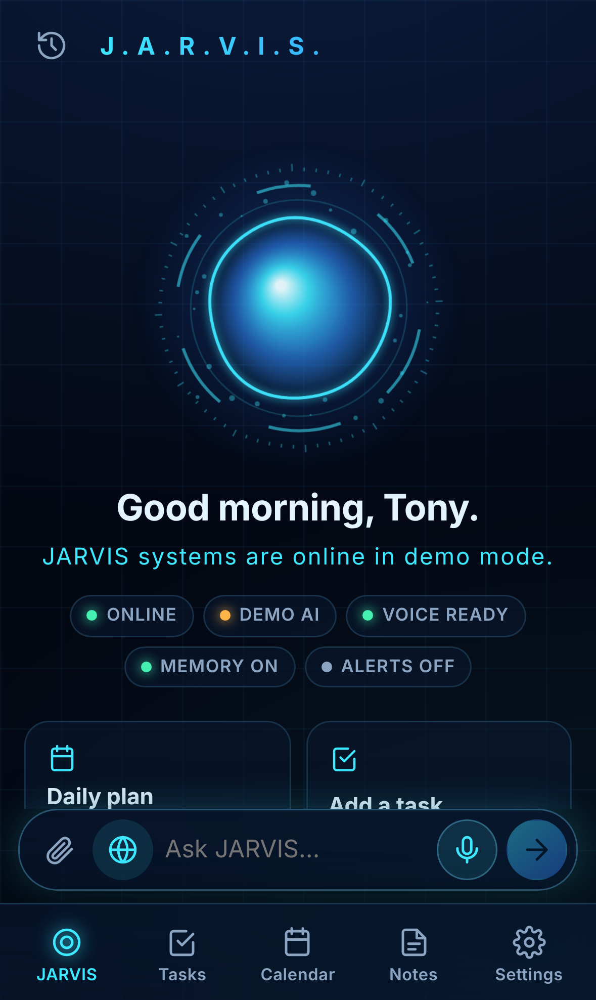
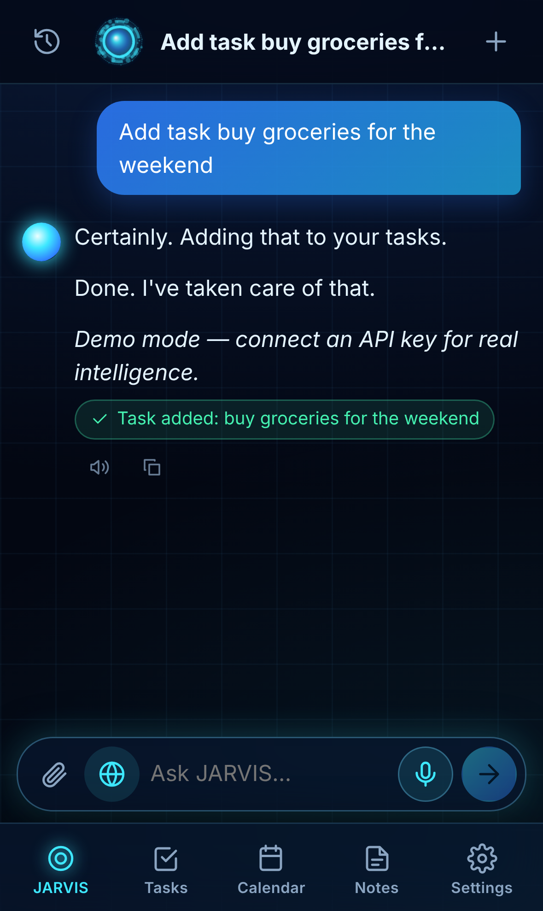
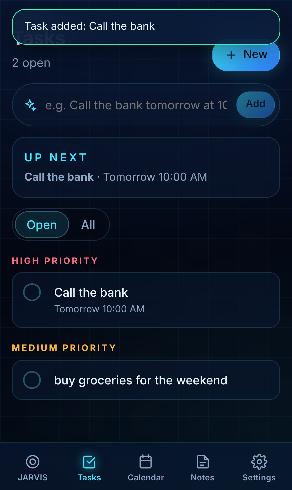
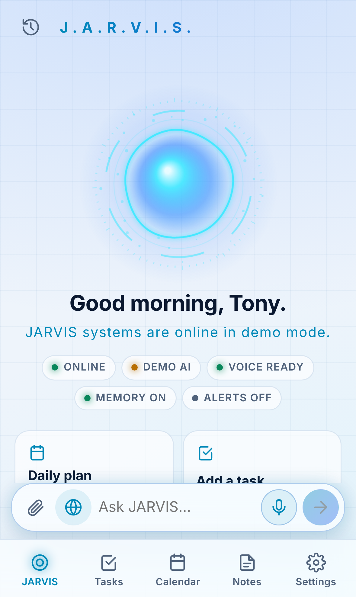
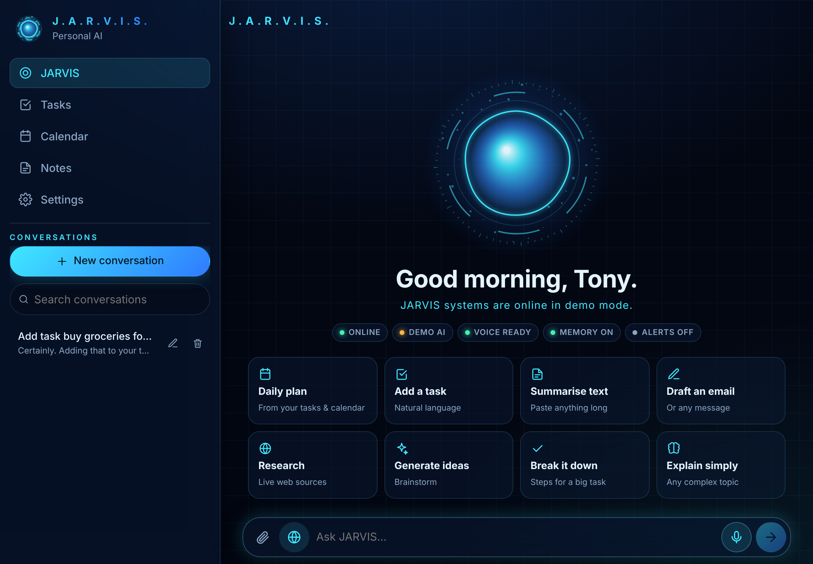

# JARVIS AI

A voice-first personal AI assistant for **iPhone and iPad**, inspired by Tony Stark's JARVIS. It's an installable Progressive Web App (PWA) with a secure Node.js backend that talks to Claude.

| iPhone | Chat | Tasks | Light mode |
|---|---|---|---|
|  |  |  |  |



_Screenshots taken in demo mode (no API key)._

## What works

- **Real AI chat** (Claude Opus 5.5 by default; Sonnet 5.5 / Haiku 5.5 selectable). Streaming replies, Markdown + code blocks with copy, long conversations, create / rename / delete / search conversations, stop generation, retry on error.
- **Voice**: speech-to-text (Web Speech API / Apple dictation), spoken replies that start while the answer is still streaming, stop-speaking button, voice picker (defaults to a British voice), speed / pitch, auto-speak toggle, text-only mode. The orb reacts to real events: listening, thinking, speaking (pulses on each spoken word).
- **Assistant actions** — JARVIS can actually create/complete tasks, add/list calendar events, save/search notes, and propose memories (saved only when you tap *Remember*).
- **Web research** with Claude's web search tool; source links are shown under the answer, and JARVIS is instructed to separate what sources say from its own conclusions.
- **Tasks**: natural-language quick add ("call the bank tomorrow 10am, urgent"), priorities, due dates, overdue highlighting, "up next".
- **Calendar**: month grid + agenda, natural-language quick add, **Apple Calendar subscription feed** (webcal) and per-event "Add to Calendar" (.ics).
- **Notes**: Markdown notes with autosave, search, preview, AI summary, export to Markdown.
- **Attachments**: photos (camera or library, downscaled on device) and PDFs for analysis/summaries.
- **Memory & personalisation**: custom instructions, response style, how JARVIS addresses you, approved memories you can view/edit/delete.
- **Notifications**: Web Push reminders for due tasks and upcoming events (iOS/iPadOS 16.4+ when installed to the Home Screen).
- **Siri & Shortcuts**: personal access tokens + plain-text endpoints for "Ask JARVIS", "Add to JARVIS", "Today's agenda", and a Share Sheet action. See [docs/IOS.md](docs/IOS.md).
- **Privacy**: accounts with scrypt-hashed passwords, HTTP-only session cookies, all data scoped per user, export everything as JSON, clear history, delete account. The API key lives only on the server.
- **Offline**: app shell and previously loaded conversations/tasks/notes are cached by the service worker; a banner explains AI is unavailable offline.
- **Demo mode**: with no API key, JARVIS clearly labels replies as scripted demo output while every other feature works — handy for trying the app.

What it deliberately does **not** claim: background listening, a wake word while the app is closed, reading device sensors/messages/other apps, or fake system telemetry. The status chips show only real states (network, AI connection, voice support, memory, notification permission).

## No computer? Set it up from your iPhone

Follow **[docs/DEPLOY-FROM-PHONE.md](docs/DEPLOY-FROM-PHONE.md)**: get a Claude API key, deploy this repo to Railway (one-click via the included `Dockerfile`), and add JARVIS to your Home Screen — all in Safari.

## Quick start (local)

Requirements: **Node.js 22.13+** (uses the built-in `node:sqlite`).

```bash
git clone <this repo> jarvis && cd jarvis
npm install
cp .env.example .env          # then put your ANTHROPIC_API_KEY in .env
npm run build                 # builds the PWA into web/dist
npm start                     # serves app + API on http://localhost:8787
```

Open http://localhost:8787 and create your account (the first account can register; sign-ups then close unless `ALLOW_SIGNUP=1`).

Development with hot reload: `npm run dev` (Vite on :5173 proxying the API on :8787).

## Run it on your iPhone / iPad

iOS requires **HTTPS** for the microphone, service worker and notifications (only `localhost` is exempt). Pick one:

1. **Quickest — a tunnel** (for testing): run `npm start`, then e.g. `cloudflared tunnel --url http://localhost:8787` or `ngrok http 8787`, and open the `https://…` URL in Safari.
2. **Your own server/VPS** (recommended for daily use): deploy behind Caddy/nginx with a TLS certificate — see [Deployment](#deployment).
3. **Home network**: Tailscale (`tailscale serve 8787`) gives you a private HTTPS URL reachable from your devices anywhere.

Then on the device:

1. Open the HTTPS URL in **Safari**.
2. Tap **Share → Add to Home Screen → Add**.
3. Launch **JARVIS** from the Home Screen (full-screen, no browser bars; safe areas for the Dynamic Island and home indicator are handled).
4. Sign in, tap the mic and allow **Microphone** and **Speech Recognition** when asked.
5. Optional: Settings → **Enable notifications**, **Subscribe in Calendar**, and create a **Shortcuts token**.

Detailed iOS permissions, Calendar subscription and Shortcuts/Siri recipes: **[docs/IOS.md](docs/IOS.md)**.

## Deployment

Any host that runs Node 22 and keeps a persistent disk for `data/` works (a small VPS, Fly.io with a volume, Railway with a volume, a home server).

```bash
npm ci && npm run build
ANTHROPIC_API_KEY=... COOKIE_SECURE=1 TRUST_PROXY=1 PORT=8787 npm start
```

Example Caddyfile (automatic HTTPS):

```
jarvis.example.com {
  reverse_proxy localhost:8787 {
    flush_interval -1   # stream chat responses immediately
  }
}
```

For nginx, disable buffering for `/api/chat` (`proxy_buffering off;`). Back up `data/jarvis.db` regularly. Run it under systemd/pm2 so it restarts on reboot.

## Project layout

```
server/            Express + TypeScript API (run with tsx)
  src/ai/          Claude provider, system prompt, tools, streaming chat loop, demo provider
  src/routes/      auth, chat/conversations, tasks/events/notes/memories, AI utilities, integrations
  src/lib/         data access (per-user), ICS, time zones, HTTP helpers
  src/push.ts      Web Push + reminder scheduler
  test/            Vitest API tests (incl. Claude request-shape test with a stubbed fetch)
web/               React + Vite PWA
  src/views/       Assistant, Tasks, Calendar, Notes, Settings, Auth
  src/components/  Orb (canvas), Markdown, conversation list, UI primitives
  src/lib/         API/SSE client, voice (STT/TTS), haptics, push, app store
  public/          manifest, service worker, icons
docs/              iOS guide and architecture notes
scripts/           Playwright end-to-end walkthrough, icon generator
```

## Scripts

| Command | What it does |
|---|---|
| `npm run dev` | API (watch) + Vite dev server |
| `npm run build` | Type-check and build the PWA |
| `npm start` | Production server (serves `web/dist` and the API) |
| `npm test` | Server test suite |
| `npm run typecheck` | Type-check server and web |
| `npm run e2e` | Playwright walkthrough at iPhone/iPad sizes against a running server with a fresh DB (`JARVIS_URL=…`) |
| `npm run vapid -w server` | Print a VAPID key pair for push (optional) |

## Architecture & roadmap

See [docs/ARCHITECTURE.md](docs/ARCHITECTURE.md) for how chat streaming, tools, memory, security and caching work, and how the optional features (live voice mode, wake word in a native shell, widgets, smart home, knowledge search) slot in.
